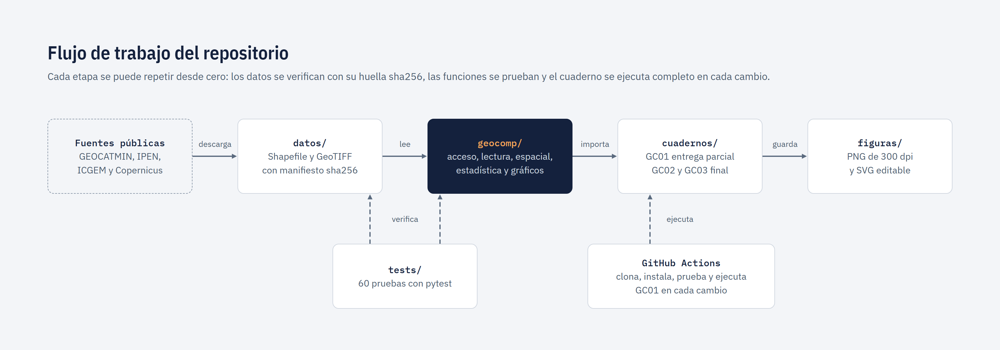
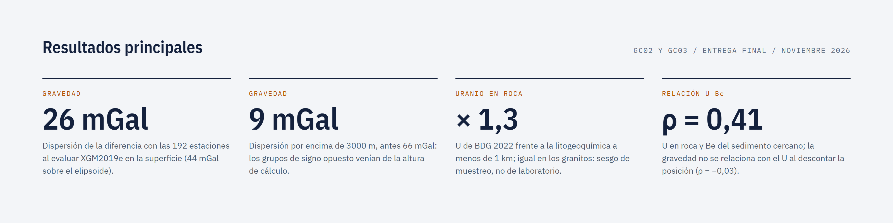
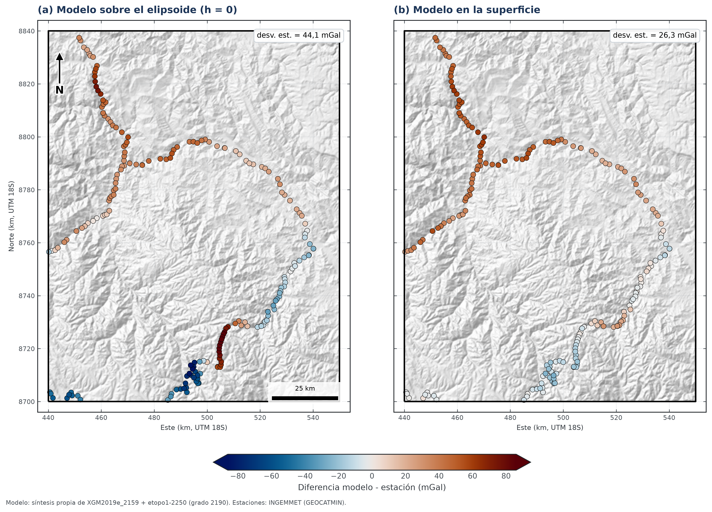
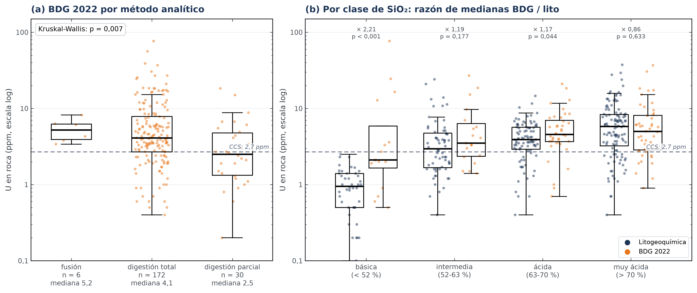
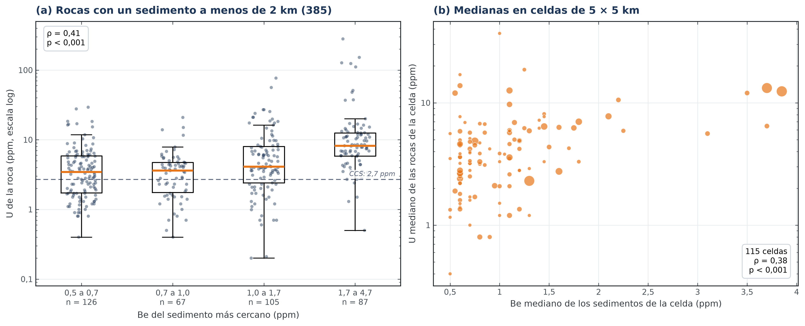

# **Prospectivity for "U - REE" - Peru Central**


[](https://github.com/HeisenbergPy/Prospectivity-for-U-REE-Peru-Central/actions/workflows/pruebas.yml)


[](https://drive.google.com/drive/folders/17-0XKJ0bYfI-5cKTVCm1R5XPFr9zsT3t?usp=drive_link)

**Autores:** Carlos Manuel Gutiérrez Cruzado y Félix Bryan Cordero Escobar<br>
**Curso:** Geocomputación (1GEO20), Pontificia Universidad Católica del Perú, semestre 2026-II

# **1. Introducción**

---
El Perú no dispone de radiometría aérea pública, la herramienta habitual en la exploración de uranio. La información
disponible proviene de varias instituciones (INGEMMET, el Instituto Peruano de Energía Nuclear y modelos globales),
que muestrearon en épocas distintas y con laboratorios y métodos distintos. Este trabajo evalúa si esas fuentes
**concuerdan** antes de integrarlas: compara **una misma variable obtenida de fuentes distintas** y analiza
estadísticamente la **relación entre variables**.

Preguntas del trabajo:

1. ¿El modelo global de gravedad XGM2019e reproduce la anomalía de Bouguer medida en las estaciones de INGEMMET?
2. ¿El uranio en roca medido por distintas instituciones es comparable?
3. ¿Con qué variables se relaciona el uranio (Th, SiO₂, Be en sedimentos y gravedad)?

**Área de estudio:** rectángulo de 110 × 140 km (15 400 km²) en la Cordillera Oriental de Junín y Pasco, en
WGS 84 / UTM 18S (EPSG:32718). **Periodo:** los datos se adquirieron entre 1991 y 2024 según la fuente.

# **2. Datos**

---
Los datos crudos del área de estudio se incluyen en la carpeta [`datos/`](datos/) (18 MB), de modo que el
repositorio puede ejecutarse inmediatamente después de clonarlo. La carpeta de
[Google Drive](https://drive.google.com/drive/folders/17-0XKJ0bYfI-5cKTVCm1R5XPFr9zsT3t?usp=drive_link) contiene una
copia idéntica.

El archivo [`datos/manifiesto.csv`](datos/manifiesto.csv) registra la fuente, la forma de acceso y la huella sha256
de cada archivo, lo que permite verificar que los datos no fueron modificados. Los campos, las licencias y el
procedimiento de obtención se describen en [`datos/LEEME.md`](datos/LEEME.md).

| Variable | Fuente | Formato | Acceso | En el área |
|---|---|---|---|---:|
| Anomalía de Bouguer | Estaciones gravimétricas de INGEMMET | Shapefile | Servicio REST de GEOCATMIN | 192 estaciones |
| Anomalía de Bouguer | Modelo global XGM2019e + ETOPO1 (Zingerle et al., 2020) | GeoTIFF | Coeficientes armónicos de ICGEM | 100 % |
| U en roca | Litogeoquímica de INGEMMET | Shapefile | GEOCATMIN | 358 rocas (330 con U) |
| U en roca | Base de Datos Geoquímicos 2022 de INGEMMET | Shapefile | GEOCATMIN | 382 rocas (235 con U) |
| U en roca | Proyecto GE27 de INGEMMET | Shapefile | GEOCATMIN | 48 muestras (45 rocas y 3 suelos) |
| U en roca | IPEN (Valencia y Mamani, 2013; Valencia, 2016) | Shapefile | Transcripción de tablas de PDF | 20 muestras (19 rocas) |
| U en roca | Boletín B-74 de INGEMMET (Carpio et al., 2021) | Shapefile | Transcripción de anexos de PDF | 7 rocas |
| Be, La, Y en sedimentos | Sedimentos de quebrada de INGEMMET | Shapefile | GEOCATMIN | 720 muestras |
| Elevación | Copernicus DEM GLO-90 | GeoTIFF | Descarga libre (AWS) | 100 % |

La grilla de XGM2019e no se descargó hecha: se calculó con una síntesis armónica propia a partir de los coeficientes
oficiales del modelo ([`scripts/sintesis_xgm2019e.py`](scripts/sintesis_xgm2019e.py)), que reproduce la grilla de
ICGEM con una diferencia máxima de 0,00002 mGal. El mismo script deja en `datos/gravedad/` el modelo evaluado en cada
estación y una segunda grilla evaluada en la superficie, que usan GC02 y GC03.

# **3. Instalación**

---
Se requiere `git` y [uv](https://docs.astral.sh/uv/), el gestor de entornos de Python. uv instala Python 3.12 y las
versiones exactas de las librerías registradas en `uv.lock`, de modo que el entorno es idéntico en cualquier equipo.

Clonar el repositorio:

```bash
git clone https://github.com/HeisenbergPy/Prospectivity-for-U-REE-Peru-Central.git
cd Prospectivity-for-U-REE-Peru-Central
```

Crear el entorno:

```bash
uv sync
```

Ejecutar las pruebas de las funciones y de los datos:

```bash
uv run pytest
```

**Sin uv:** en un entorno de Python 3.12, el paquete se instala con:

```bash
pip install -e . pytest
```

# **4. Estructura y flujo de trabajo**

---


El análisis se organiza en cuadernos de Jupyter, uno por etapa, en la carpeta [`cuadernos/`](cuadernos/). Las
funciones que emplean se encuentran en el paquete [`geocomp/`](geocomp/), y cada una cuenta con pruebas en
[`tests/`](tests/) (85 pruebas). Los dos scripts de [`scripts/`](scripts/) documentan cómo se obtuvieron los datos.

| Cuaderno | Contenido | Entrega | Estado |
|---|---|---|:---:|
| [GC01 - Acceso a los datos y exploración](cuadernos/GC01_avance_exploracion.ipynb) | Integridad de los datos, fuentes y forma de acceso, primera comparación de fuentes, cobertura y periodo | Parcial (16/10/2026) | ✔️ |
| [GC02 - Validación de las fuentes](cuadernos/GC02_validacion_fuentes.ipynb) | Reducción de las estaciones, modelo evaluado en la superficie, corrección de terreno, Bland-Altman; U por pares, distancia, método analítico y tipo de roca | Final (22/11/2026) | ✔️ |
| [GC03 - Relación del uranio con otras variables](cuadernos/GC03_relacion_variables.ipynb) | U frente a Th, SiO₂, Be del sedimento cercano y gravedad (total y residual), con correlación parcial y matriz de correlaciones | Final (22/11/2026) | ✔️ |

| Módulo de `geocomp/` | Función |
|---|---|
| `rutas.py` | Rutas de los archivos y sistemas de coordenadas |
| `acceso.py` | Consulta y descarga desde GEOCATMIN, ICGEM y AWS; verificación de los archivos con su huella sha256 |
| `lectura.py` | Lectura de cada capa, conversión de la química (texto como `'<2.00'` o `'########'`) a números y depuración (menas, vetas y réplicas) |
| `espacial.py` | Muestreo de rásteres y matrices en puntos, pares de muestras cercanas, reproyección y cobertura en una grilla |
| `gravedad.py` | Síntesis armónica de modelos globales (grado 2190), reducción de Bouguer, corrección de terreno y separación regional-residual |
| `estadistica.py` | Acuerdo entre fuentes (sesgo, RMS, Bland-Altman, bootstrap), regresión logarítmica y correlación parcial |
| `graficos.py` | Estilo de las figuras, mapas en UTM con norte y escala, diagramas geoquímicos (regiones del 50 %, medianas Q1-Q3, razones Th/U) |

| Script de `scripts/` | Función |
|---|---|
| `descargar_datos.py` | Vuelve a descargar las cinco capas de GEOCATMIN, el DEM y los coeficientes de ICGEM en `descargas/` y los compara con `datos/` (no lo modifica) |
| `sintesis_xgm2019e.py` | Calcula la grilla de XGM2019e, la compara con la de `datos/` y obtiene el modelo en la superficie y en cada estación |

# **5. Ejecución**

---
Abrir Jupyter en el entorno del proyecto:

```bash
uv run jupyter notebook
```

Ejecutar los tres cuadernos desde la terminal sin modificar los originales (el resultado se guarda en `salida/`):

```bash
uv run jupyter nbconvert --to notebook --execute cuadernos/*.ipynb --output-dir salida
```

Comprobar la copia de los datos con sus fuentes y rehacer la síntesis del modelo de gravedad (requieren internet;
la síntesis descarga 420 MB de coeficientes y tarda unos dos minutos):

```bash
uv run python scripts/descargar_datos.py
uv run python scripts/sintesis_xgm2019e.py
```

En cada cambio, GitHub Actions clona el repositorio desde cero, crea el entorno, ejecuta las pruebas y los tres
cuadernos completos ([`.github/workflows/pruebas.yml`](.github/workflows/pruebas.yml)). La descarga y la síntesis se
pueden ejecutar en GitHub a pedido ([`.github/workflows/fuentes.yml`](.github/workflows/fuentes.yml)). Las imágenes de
este README se generan como se indica en [`recursos/LEEME.md`](recursos/LEEME.md).

# **6. Resultados**

---


**1. Gravedad: ¿XGM2019e reproduce las estaciones?** Solo si se evalúa donde se midió. Las estaciones de INGEMMET son
anomalías de Bouguer simples (ρ = 2670 kg/m³, sin corrección de terreno), lo que se comprobó recalculándolas con su
gravedad observada. Evaluado sobre el elipsoide, como la grilla de GC01, el modelo difiere de las estaciones con una
dispersión de 44 mGal, que llega a 66 mGal por encima de 3000 m; evaluado en la superficie, la dispersión baja a
26 mGal (9 mGal en las estaciones altas) y los dos grupos de signo opuesto de GC01 desaparecen. Queda un sesgo que
disminuye con la elevación (+30 mGal en los valles a −20 mGal en la puna): el modelo describe el patrón regional,
pero no sustituye a las mediciones en un estudio local.



**2. Uranio: ¿las fuentes son comparables?** Sí en las rocas graníticas. En pares a menos de 1 km, BDG 2022 mide
unas 1,3 veces el U de la litogeoquímica, diferencia apenas significativa que se concentra en rocas básicas tomadas
en labores mineras; en las rocas muy ácidas ambas coinciden, y GE27 coincide con la litogeoquímica. La digestión
parcial subestima el U. La variabilidad entre muestras cercanas (factores de 0,2 a 11) supera cualquier sesgo entre
fuentes: el principal problema al integrarlas es la representatividad, no el laboratorio.



**3. ¿Con qué se relaciona el U?** Con el Th de la misma roca (ρ = 0,80, con Th/U constante salvo en las rocas con U
añadido), con el SiO₂ (el U se multiplica por 1,9 cada 10 % en la litogeoquímica) y con el Be del sedimento de
quebrada más cercano (ρ = 0,41, estable con la distancia, en celdas y al descontar la elevación). Con la gravedad, la
correlación simple (ρ = −0,12) desaparece al descontar la posición este-oeste (ρ parcial = −0,03), y la anomalía
residual no da un resultado estable: a esta escala, la gravedad del modelo global no informa sobre el U.



# **7. Referencias**

---
- Barthelmes, F. (2013). [*Definition of functionals of the geopotential and their calculation from spherical harmonic models*](https://doi.org/10.2312/GFZ.b103-0902-26) (Scientific Technical Report STR09/02). GFZ Potsdam.
- Bland, J. M., y Altman, D. G. (1986). [Statistical methods for assessing agreement between two methods of clinical measurement](https://doi.org/10.1016/S0140-6736(86)90837-8). *The Lancet, 327*(8476), 307-310.
- Carpio et al. (2021). [*Prospección del litio en el norte y centro del Perú*](https://hdl.handle.net/20.500.12544/3542) (Boletín B-74). INGEMMET.
- Cuney, M. (2014). [Felsic magmatism and uranium deposits](https://doi.org/10.2113/gssgfbull.185.2.75). *Bulletin de la Société Géologique de France, 185*(2), 75-92.
- European Space Agency (2021). [*Copernicus Global Digital Elevation Model* (GLO-90)](https://doi.org/10.5069/G9028PQB). Distribuido por OpenTopography.
- Hammer, S. (1939). [Terrain corrections for gravimeter stations](https://doi.org/10.1190/1.1440495). *Geophysics, 4*(3), 184-194.
- Hofmann-Wellenhof, B., y Moritz, H. (2006). [*Physical geodesy*](https://doi.org/10.1007/978-3-211-33545-1) (2.ª ed.). Springer.
- LaFehr, T. R. (1991). [Standardization in gravity reduction](https://doi.org/10.1190/1.1443137). *Geophysics, 56*(8), 1170-1178.
- Mišković, A., Spikings, R. A., Chew, D. M., Košler, J., Ulianov, A., y Schaltegger, U. (2009). [Tectonomagmatic evolution of Western Amazonia: Geochemical characterization and zircon U-Pb geochronologic constraints from the Peruvian Eastern Cordilleran granitoids](https://doi.org/10.1130/B26488.1). *GSA Bulletin, 121*(9-10), 1298-1324.
- Moritz, H. (2000). [Geodetic Reference System 1980](https://doi.org/10.1007/s001900050278). *Journal of Geodesy, 74*(1), 128-133.
- Rudnick, R. L., y Gao, S. (2003). [Composition of the continental crust](https://doi.org/10.1016/B0-08-043751-6/03016-4). En *Treatise on Geochemistry* (vol. 3, pp. 1-64). Elsevier.
- Valencia y Mamani (2013). En *Informe Científico Tecnológico 2011* (pp. 79-84). Instituto Peruano de Energía Nuclear.
- Valencia (2016). En *Informe Científico Tecnológico*, vol. 14 (p. 131). Instituto Peruano de Energía Nuclear.
- Zingerle, P., Pail, R., Gruber, T., y Oikonomidou, X. (2020). [The combined global gravity field model XGM2019e](https://doi.org/10.1007/s00190-020-01398-0). *Journal of Geodesy, 94*, 66.

# **8. Declaración de uso de inteligencia artificial**

---
Se utilizó una herramienta de inteligencia artificial generativa como apoyo en la edición estética de las gráficas:
formato, paleta de colores, tipografía y composición de las figuras y de las imágenes de este README.

# **9. Licencia y cita**

---
El código se distribuye bajo la licencia MIT (ver [`LICENSE`](LICENSE)). Los datos conservan la licencia y la cita de
su fuente original (ver [`datos/LEEME.md`](datos/LEEME.md)). Para citar este trabajo puede usarse la opción
*Cite this repository* de GitHub o el archivo [`CITATION.cff`](CITATION.cff).
