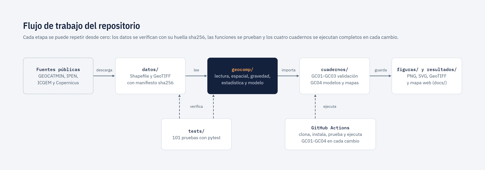
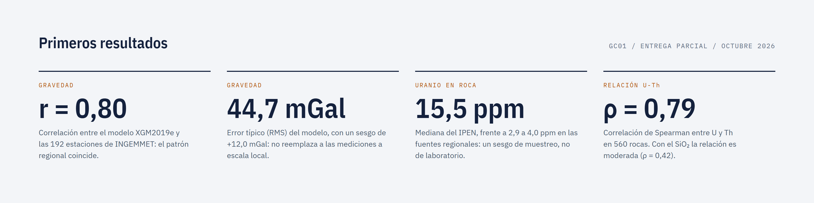
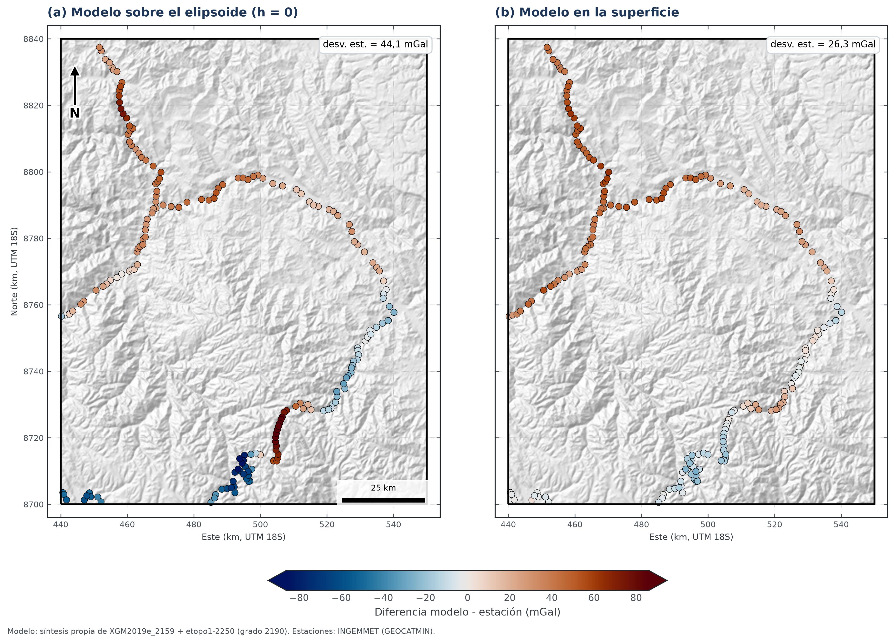
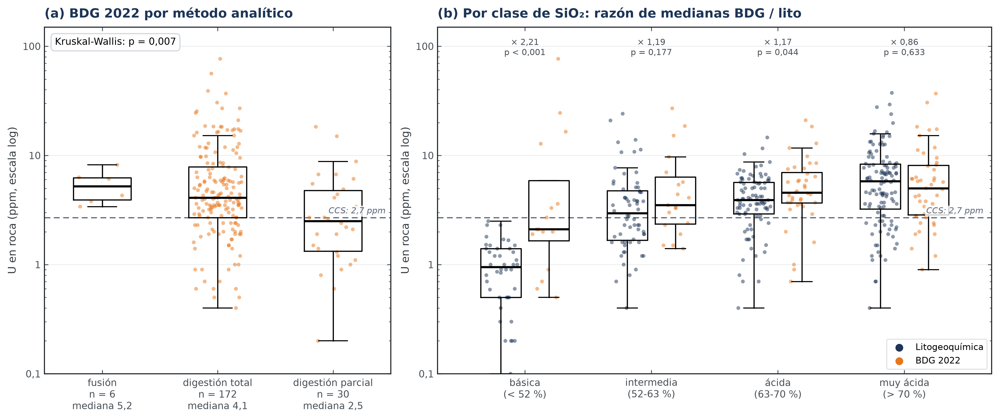
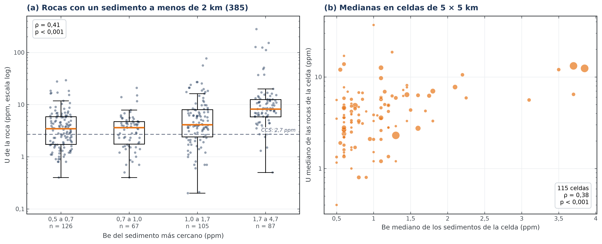
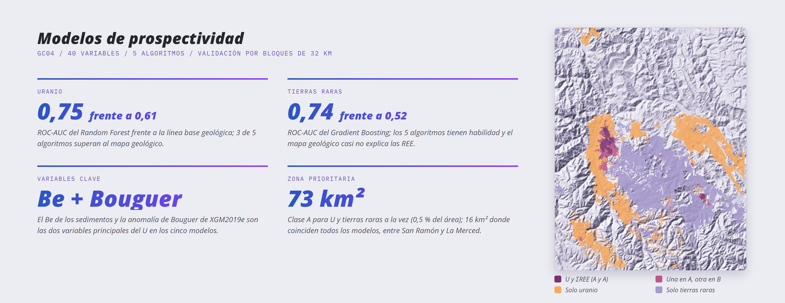
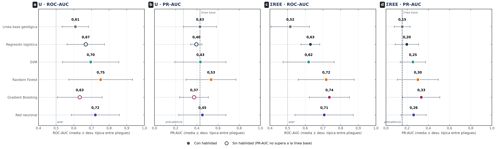
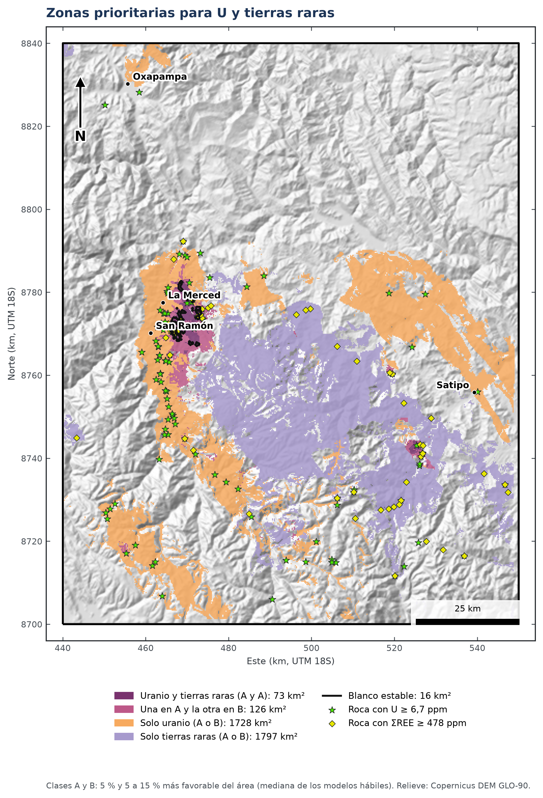

# **Prospectivity for "U - REE" - Peru Central**



[](https://github.com/HeisenbergPy/Prospectivity-for-U-REE-Peru-Central/actions/workflows/pruebas.yml)
[](https://heisenbergpy.github.io/Prospectivity-for-U-REE-Peru-Central/)
[](https://colab.research.google.com/github/HeisenbergPy/Prospectivity-for-U-REE-Peru-Central/blob/main/cuadernos/GC04_modelo_prospectividad.ipynb)


[](https://drive.google.com/drive/folders/17-0XKJ0bYfI-5cKTVCm1R5XPFr9zsT3t?usp=drive_link)

**Autores:** Carlos Manuel Gutiérrez Cruzado y Félix Bryan Cordero Escobar<br>
**Curso:** Geocomputación (1GEO20), Pontificia Universidad Católica del Perú, semestre 2026-II

> **In English.** A reproducible Python workflow for uranium and rare earth element (REE) prospectivity in the Eastern
> Cordillera of central Peru, built only from public data. It validates two public sources of the same variables
> (gravity stations against the XGM2019e global model; uranium in rock from five surveys), integrates 40 predictors on
> a 250 m grid, and trains five machine learning models (logistic regression, SVM, random forest, gradient boosting and
> a neural network) with nested cross-validation on 32 km spatial blocks, against a geological baseline. Stream
> sediment beryllium and Bouguer gravity are the leading predictors of uranium in all five models. The cells in the top
> 5 % for both U and REE cover 73 km². Open the [interactive map](https://heisenbergpy.github.io/Prospectivity-for-U-REE-Peru-Central/)
> or run [GC04 in Colab](https://colab.research.google.com/github/HeisenbergPy/Prospectivity-for-U-REE-Peru-Central/blob/main/cuadernos/GC04_modelo_prospectividad.ipynb).

# **1. Introducción**

---
En el Perú no hay radiometría aérea pública, que es la herramienta usual para explorar uranio. Lo que existe son
datos de INGEMMET, del Instituto Peruano de Energía Nuclear (IPEN) y de modelos globales, tomados en distintos años y
analizados con métodos distintos. En este trabajo comparamos las fuentes, analizamos con qué variables se relaciona
el uranio y, con esos resultados, entrenamos modelos de prospectividad para uranio y tierras raras (ΣREE).

Preguntas:

1. ¿El modelo global de gravedad XGM2019e reproduce la anomalía de Bouguer de las estaciones de INGEMMET?
2. ¿El uranio en roca medido por distintas instituciones es comparable?
3. ¿Con qué variables se relaciona el uranio (Th, SiO₂, Be en sedimentos y gravedad)?
4. ¿Dónde es más favorable encontrar uranio y tierras raras con los datos públicos disponibles?

**Área de estudio:** rectángulo de 110 × 140 km (15 400 km²) en la Cordillera Oriental de Junín y Pasco, en
WGS 84 / UTM 18S (EPSG:32718).<br>
**Periodo:** los datos son de 1991 a 2024, según la fuente.

# **2. Datos**

---
Los datos del área de estudio están en [`datos/`](datos/) (32 MB), así que el repositorio funciona apenas se
clona. La misma carpeta está en
[Google Drive](https://drive.google.com/drive/folders/17-0XKJ0bYfI-5cKTVCm1R5XPFr9zsT3t?usp=drive_link).
En [`datos/manifiesto.csv`](datos/manifiesto.csv) está la fuente, la forma de acceso y la huella sha256 de cada
archivo, y en [`datos/LEEME.md`](datos/LEEME.md) los campos, las licencias y cómo se obtuvo cada fuente.

| Variable | Fuente | Formato | Acceso | En el área |
|---|---|---|---|---:|
| Anomalía de Bouguer | Estaciones gravimétricas de INGEMMET | Shapefile | Servicio REST de GEOCATMIN | 192 estaciones |
| Anomalía de Bouguer | Modelo global XGM2019e + ETOPO1 (Zingerle et al., 2020) | GeoTIFF | Coeficientes armónicos de ICGEM | 100 % |
| U en roca | Litogeoquímica de INGEMMET | Shapefile | GEOCATMIN | 358 rocas (330 con U) |
| U en roca | Base de Datos Geoquímicos 2022 de INGEMMET | Shapefile | GEOCATMIN | 382 rocas (235 con U) |
| U en roca | Proyecto GE27 de INGEMMET | Shapefile | GEOCATMIN | 48 muestras (45 rocas y 3 suelos) |
| U en roca | IPEN (Valencia y Mamani, 2013; Valencia, 2016) | Shapefile | Transcripción de tablas de PDF | 20 muestras (19 rocas) |
| U en roca | Boletín B-74 de INGEMMET (Carpio et al., 2021) | Shapefile | Transcripción de anexos de PDF | 7 rocas |
| Be, La, Y en sedimentos | Sedimentos de quebrada de INGEMMET | Shapefile | GEOCATMIN | 720 muestras |
| Elevación | Copernicus DEM GLO-90 | GeoTIFF | Descarga libre (AWS) | 100 % |
| 40 variables del modelo | Geología, fallas, sedimentos, gravedad, magnetismo (EMAG2v3), relieve y Landsat 8/9, en una grilla de 250 m | GeoTIFF y CSV | Integración propia (`datos/modelo/`) | 100 % |

La grilla de XGM2019e la calculamos nosotros a partir de los coeficientes del modelo, porque las descargas de ICGEM
fallaban. El script [`scripts/sintesis_xgm2019e.py`](scripts/sintesis_xgm2019e.py) la vuelve a calcular (la diferencia
con la de ICGEM es menor que 0,0001 mGal) y genera además el modelo en cada estación y una grilla en la superficie,
que se usan en GC02 y GC03. Las variables del modelo son datos integrados; GC04 comprueba que el Be de los
sedimentos, la gravedad y la elevación se rehacen exactamente desde los datos del repositorio.

# **3. Instalación**

---
Se necesita `git` y [uv](https://docs.astral.sh/uv/). uv instala Python 3.12 y las mismas versiones de librerías
que están en `uv.lock`.

```bash
git clone https://github.com/HeisenbergPy/Prospectivity-for-U-REE-Peru-Central.git
cd Prospectivity-for-U-REE-Peru-Central
uv sync
```

Para correr las pruebas:

```bash
uv run pytest
```

Sin uv, en un entorno de Python 3.12: `pip install -e . pytest`. Sin instalar nada, GC04 se abre en
[Google Colab](https://colab.research.google.com/github/HeisenbergPy/Prospectivity-for-U-REE-Peru-Central/blob/main/cuadernos/GC04_modelo_prospectividad.ipynb):
su primera celda descarga el repositorio.

# **4. Estructura**

---


```
datos/        datos del área, variables del modelo y manifiesto con las huellas sha256
geocomp/      funciones que usan los cuadernos
cuadernos/    GC01, GC02, GC03 y GC04
scripts/      descarga de las fuentes, síntesis de XGM2019e y mapa interactivo
tests/        pruebas de las funciones y de los datos
figuras/      figuras que generan los cuadernos (PNG y SVG)
resultados/   mapas de favorabilidad que genera GC04 (GeoTIFF)
docs/         mapa interactivo (GitHub Pages)
recursos/     imágenes de este README
```

| Cuaderno | Contenido | Entrega |
|---|---|---|
| [GC01 - Acceso a los datos y exploración](cuadernos/GC01_avance_exploracion.ipynb) | Integridad de los datos, fuentes, primera comparación, cobertura y periodo | Parcial (16/10/2026) |
| [GC02 - Validación de las fuentes](cuadernos/GC02_validacion_fuentes.ipynb) | Gravedad: reducción de las estaciones, modelo en la superficie, corrección de terreno. Uranio: pares de muestras, método analítico y tipo de roca | Final (22/11/2026) |
| [GC03 - Relación del uranio con otras variables](cuadernos/GC03_relacion_variables.ipynb) | U frente a Th, SiO₂, Be en sedimentos y gravedad | Final (22/11/2026) |
| [GC04 - Integración de variables y modelos de prospectividad](cuadernos/GC04_modelo_prospectividad.ipynb) | 40 variables, cinco algoritmos con validación anidada por bloques, mapas de favorabilidad, consenso, franja de prueba, azar espacial y zonas prioritarias | Final (22/11/2026) |

| Módulo | Qué hace |
|---|---|
| `geocomp/rutas.py` | Rutas de los archivos y sistemas de coordenadas |
| `geocomp/acceso.py` | Descargas de GEOCATMIN, ICGEM y AWS, y verificación de las huellas sha256 |
| `geocomp/lectura.py` | Lectura de las capas, química de texto a número (`'<2.00'`, `'########'`) y depuración de menas, vetas y réplicas |
| `geocomp/espacial.py` | Valores de rásteres en puntos, pares de muestras cercanas, reproyección, promedio gaussiano y cobertura |
| `geocomp/gravedad.py` | Síntesis armónica, anomalía de Bouguer, corrección de terreno y separación regional-residual |
| `geocomp/estadistica.py` | Sesgo, RMS, Bland-Altman, bootstrap, regresión logarítmica y correlación parcial |
| `geocomp/modelo.py` | Bloques espaciales, línea base geológica, cinco algoritmos con validación anidada, percentiles, consenso y traslación toroidal |
| `geocomp/graficos.py` | Estilo de las figuras, mapas y diagramas geoquímicos |

# **5. Ejecución**

---
Abrir los cuadernos:

```bash
uv run jupyter notebook
```

Ejecutar los cuatro cuadernos desde la terminal (los resultados quedan en `salida/` y los originales no cambian;
GC04 tarda unos 15 minutos):

```bash
uv run jupyter nbconvert --to notebook --execute cuadernos/*.ipynb --output-dir salida
```

Volver a descargar las fuentes y compararlas con `datos/`, y rehacer la síntesis de XGM2019e (necesitan internet; la
síntesis descarga 420 MB de coeficientes):

```bash
uv run python scripts/descargar_datos.py
uv run python scripts/sintesis_xgm2019e.py
```

Rehacer el mapa interactivo de `docs/` después de ejecutar GC04:

```bash
uv run python scripts/mapa_web.py
```

Con cada cambio, GitHub Actions instala el entorno desde cero, corre las pruebas y ejecuta los cuatro cuadernos
([`pruebas.yml`](.github/workflows/pruebas.yml)). La descarga y la síntesis se pueden correr a mano desde la pestaña
Actions ([`fuentes.yml`](.github/workflows/fuentes.yml)).

# **6. Resultados**

---


**Gravedad.** Las estaciones de INGEMMET tienen anomalía de Bouguer simple (ρ = 2670 kg/m³, sin corrección de
terreno); lo comprobamos recalculándolas con su gravedad observada. En GC01 comparamos con la grilla calculada sobre
el elipsoide y la diferencia tenía una desviación de 44 mGal. Calculando el modelo a la altura de cada estación baja
a 26 mGal, y en las estaciones de más de 3000 m pasa de 66 a 9 mGal. Los dos grupos de signo opuesto que vimos en
GC01 se debían a esto. Todavía queda un sesgo que cambia con la elevación (unos +30 mGal en los valles y −20 mGal en
la puna), por eso el modelo sirve para el patrón regional pero no reemplaza a las estaciones.



**Uranio.** En pares de muestras a menos de 1 km, BDG 2022 da una mediana de 1,3 veces el U de la litogeoquímica
(p = 0,03). La diferencia está sobre todo en rocas básicas muestreadas en minas; en las rocas muy ácidas las dos
fuentes dan lo mismo, y GE27 coincide con la litogeoquímica. La digestión parcial de BDG da menos U. Entre muestras
cercanas el U puede variar de 0,2 a 11 veces, mucho más que la diferencia entre fuentes.



**Relación con otras variables.** El U se relaciona con el Th de la misma roca (ρ = 0,80), con el SiO₂ (en la
litogeoquímica el U se multiplica por 1,9 por cada 10 % de SiO₂) y con el Be del sedimento de quebrada más cercano
(ρ = 0,41, también al controlar la elevación). Con la gravedad la correlación es de −0,12, pero desaparece cuando se
controla la posición este-oeste (−0,03), porque las dos variables cambian de oeste a este. La anomalía residual
tampoco da un resultado estable.





**Modelos de prospectividad.** Con 40 variables y validación anidada por bloques de 32 km, el Random Forest de U
alcanza un ROC-AUC de 0,75 y una PR-AUC de 0,54, frente a 0,61 y 0,43 de la línea base geológica (la tasa de
positivos de cada grupo del mapa geológico); tres de los cinco algoritmos la superan. En tierras raras el mejor es el
Gradient Boosting (0,74 y 0,33 frente a 0,52 y 0,15) y los cinco superan a la línea base. El Be de los sedimentos y
la anomalía de Bouguer de XGM2019e son las dos variables principales del U en los cinco modelos: el U es más
favorable donde hay más Be y la anomalía es más negativa, como se espera sobre granitos evolucionados y poco densos.



**Zonas prioritarias.** Los mapas se expresan en percentiles del área, porque las probabilidades no están calibradas. Las celdas
en la clase A (5 % más favorable) para U y para ΣREE a la vez suman 73 km², y el blanco donde coinciden todos los
modelos, 16 km² entre San Ramón y La Merced. En la franja sur reservada como prueba, el modelo de U supera a la línea
base (ROC-AUC de 0,70 frente a 0,63). La prueba contra el azar espacial no es significativa (p = 0,10 para U), porque
los positivos están muy agrupados: los mapas sirven para decidir dónde muestrear primero, pero no prueban que haya
mineralización.
Los mapas se pueden recorrer en el [mapa interactivo](https://heisenbergpy.github.io/Prospectivity-for-U-REE-Peru-Central/).



# **7. Referencias**

---
- Barthelmes, F. (2013). [*Definition of functionals of the geopotential and their calculation from spherical harmonic models*](https://doi.org/10.2312/GFZ.b103-0902-26) (Scientific Technical Report STR09/02). GFZ Potsdam.
- Bland, J. M., y Altman, D. G. (1986). [Statistical methods for assessing agreement between two methods of clinical measurement](https://doi.org/10.1016/S0140-6736(86)90837-8). *The Lancet, 327*(8476), 307-310.
- Carpio et al. (2021). [*Prospección del litio en el norte y centro del Perú*](https://hdl.handle.net/20.500.12544/3542) (Boletín B-74). INGEMMET.
- Cuney, M. (2014). [Felsic magmatism and uranium deposits](https://doi.org/10.2113/gssgfbull.185.2.75). *Bulletin de la Société Géologique de France, 185*(2), 75-92.
- European Space Agency (2021). [*Copernicus Global Digital Elevation Model* (GLO-90)](https://doi.org/10.5069/G9028PQB). Distribuido por OpenTopography.
- Fortin, M.-J., y Dale, M. R. T. (2005). [*Spatial analysis: A guide for ecologists*](https://doi.org/10.1017/CBO9780511542039). Cambridge University Press.
- Hammer, S. (1939). [Terrain corrections for gravimeter stations](https://doi.org/10.1190/1.1440495). *Geophysics, 4*(3), 184-194.
- Hofmann-Wellenhof, B., y Moritz, H. (2006). [*Physical geodesy*](https://doi.org/10.1007/978-3-211-33545-1) (2.ª ed.). Springer.
- LaFehr, T. R. (1991). [Standardization in gravity reduction](https://doi.org/10.1190/1.1443137). *Geophysics, 56*(8), 1170-1178.
- Meyer, B., Saltus, R., y Chulliat, A. (2017). [*EMAG2: Earth Magnetic Anomaly Grid (2-arc-minute resolution)*, versión 3](https://doi.org/10.7289/V5H70CVX) [Conjunto de datos]. NOAA National Centers for Environmental Information.
- Mišković, A., Spikings, R. A., Chew, D. M., Košler, J., Ulianov, A., y Schaltegger, U. (2009). [Tectonomagmatic evolution of Western Amazonia: Geochemical characterization and zircon U-Pb geochronologic constraints from the Peruvian Eastern Cordilleran granitoids](https://doi.org/10.1130/B26488.1). *GSA Bulletin, 121*(9-10), 1298-1324.
- Moritz, H. (2000). [Geodetic Reference System 1980](https://doi.org/10.1007/s001900050278). *Journal of Geodesy, 74*(1), 128-133.
- Pedregosa, F., et al. (2011). [Scikit-learn: Machine learning in Python](https://jmlr.org/papers/v12/pedregosa11a.html). *Journal of Machine Learning Research, 12*, 2825-2830.
- Roberts, D. R., et al. (2017). [Cross-validation strategies for data with temporal, spatial, hierarchical, or phylogenetic structure](https://doi.org/10.1111/ecog.02881). *Ecography, 40*(8), 913-929.
- Rudnick, R. L., y Gao, S. (2003). [Composition of the continental crust](https://doi.org/10.1016/B0-08-043751-6/03016-4). En *Treatise on Geochemistry* (vol. 3, pp. 1-64). Elsevier.
- Saito, T., y Rehmsmeier, M. (2015). [The precision-recall plot is more informative than the ROC plot when evaluating binary classifiers on imbalanced datasets](https://doi.org/10.1371/journal.pone.0118432). *PLOS ONE, 10*(3), e0118432.
- Valencia y Mamani (2013). En *Informe Científico Tecnológico 2011* (pp. 79-84). Instituto Peruano de Energía Nuclear.
- Valencia (2016). En *Informe Científico Tecnológico*, vol. 14 (p. 131). Instituto Peruano de Energía Nuclear.
- Zingerle, P., Pail, R., Gruber, T., y Oikonomidou, X. (2020). [The combined global gravity field model XGM2019e](https://doi.org/10.1007/s00190-020-01398-0). *Journal of Geodesy, 94*, 66.

# **8. Declaración de uso de inteligencia artificial**

---
Se utilizó inteligencia artificial generativa como herramienta de apoyo en la programación y en la preparación de
textos y figuras. Los autores definieron el problema, las fuentes y los criterios del análisis, y revisaron y
validaron todos los resultados.

# **9. Licencia y cita**

---
El código tiene licencia MIT ([`LICENSE`](LICENSE)). Los datos mantienen la licencia y la cita de su fuente
([`datos/LEEME.md`](datos/LEEME.md)). Para citar el trabajo se puede usar *Cite this repository* en GitHub o
[`CITATION.cff`](CITATION.cff).
