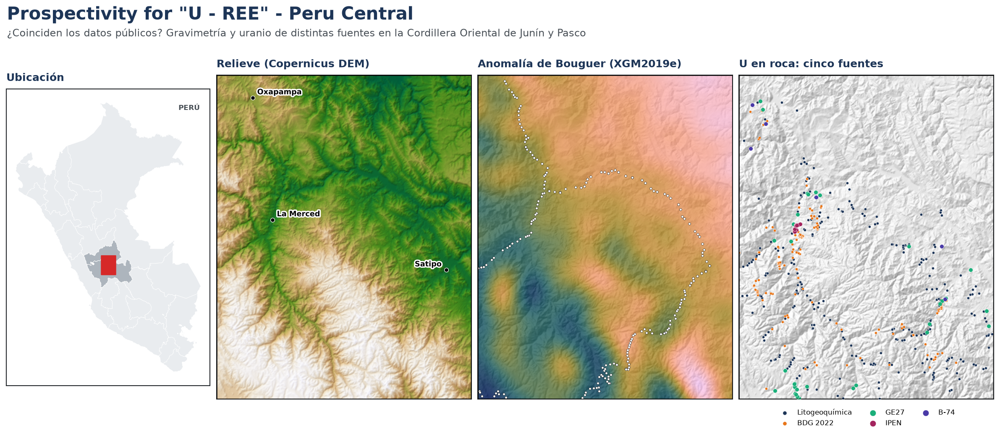
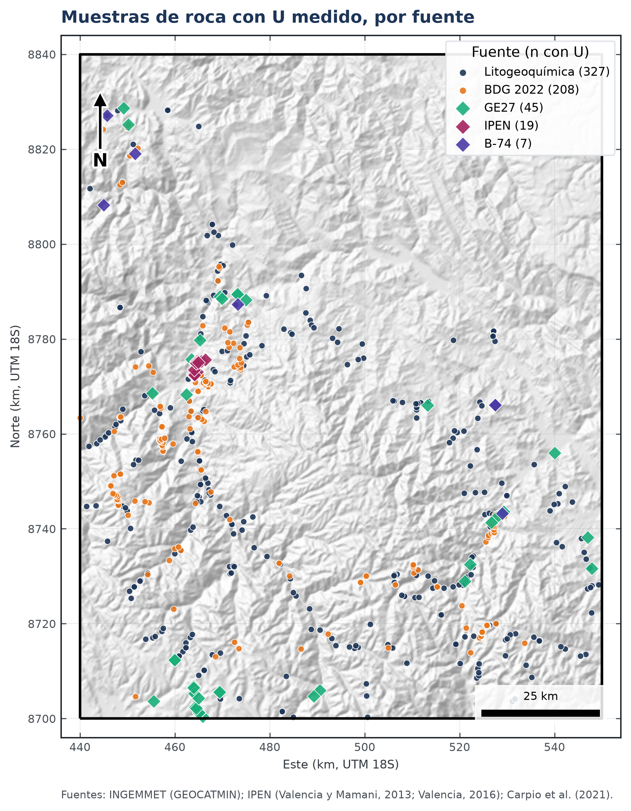
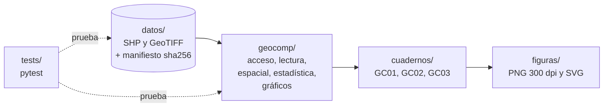
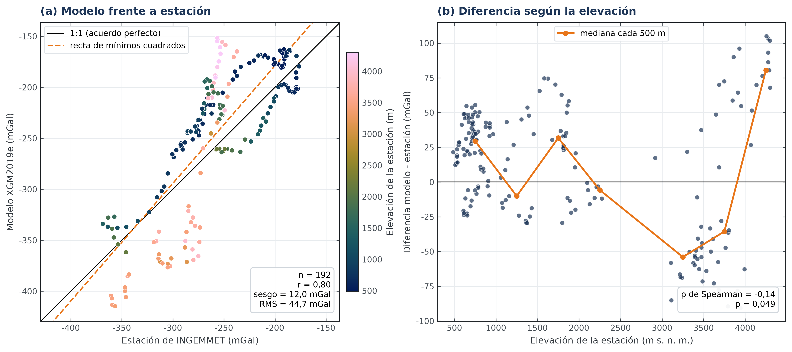
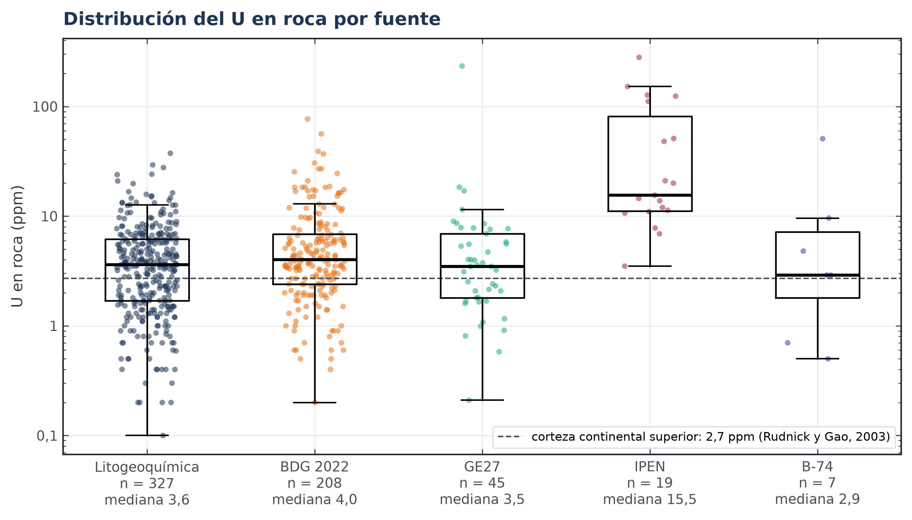

# **Prospectivity for "U - REE" - Peru Central**



[](https://github.com/HeisenbergPy/Prospectivity-for-U-REE-Peru-Central/actions/workflows/pruebas.yml)


**Autores:** Carlos Manuel Gutiérrez Cruzado y Félix Bryan Cordero Escobar<br>
**Curso:** Geocomputación (1GEO20), Pontificia Universidad Católica del Perú, semestre 2026-II

# **1. Introducción**

---
El Perú no tiene radiometría aérea pública, que es la herramienta habitual para buscar uranio. Para explorar hay que
juntar datos de varias instituciones (INGEMMET, el Instituto Peruano de Energía Nuclear y modelos globales) que
muestrearon en años distintos y con laboratorios distintos. En este trabajo comprobamos si esas fuentes **concuerdan**
antes de usarlas juntas: comparamos **una misma variable obtenida de fuentes distintas** y analizamos estadísticamente
la **relación entre variables**.

Las preguntas del trabajo son:

1. ¿El modelo global de gravedad XGM2019e reproduce la anomalía de Bouguer medida en las estaciones de INGEMMET?
2. ¿El uranio en roca medido por distintas instituciones es comparable?
3. ¿Con qué variables se relaciona el uranio (Th, SiO₂, Be en sedimentos y gravedad)?

**Área de estudio:** rectángulo de 110 × 140 km (15 400 km²) en la Cordillera Oriental de Junín y Pasco, en
WGS 84 / UTM 18S (EPSG:32718). **Periodo:** los datos se tomaron entre 1991 y 2024 según la fuente.

# **2. Datos**

---
Todos los datos están en la carpeta [`datos/`](datos/) (18 MB), así que el repositorio funciona apenas se clona. La
copia en Google Drive es idéntica: **[enlace por agregar]**.

Cada archivo tiene su fuente, su forma de acceso y su huella sha256 en [`datos/manifiesto.csv`](datos/manifiesto.csv).
La huella permite comprobar que los datos son los mismos que se descargaron. Los campos, las licencias y cómo se obtuvo
cada archivo están en [`datos/LEEME.md`](datos/LEEME.md).

| Variable | Fuente | Formato | Acceso | En el área |
|---|---|---|---|---:|
| Anomalía de Bouguer | Estaciones gravimétricas de INGEMMET | Shapefile | Servicio REST de GEOCATMIN | 192 estaciones |
| Anomalía de Bouguer | Modelo global XGM2019e + ETOPO1 (Zingerle et al., 2020) | GeoTIFF | Coeficientes armónicos de ICGEM | 100 % |
| U en roca | Litogeoquímica de INGEMMET | Shapefile | GEOCATMIN | 358 rocas (330 con U) |
| U en roca | Base de Datos Geoquímicos 2022 de INGEMMET | Shapefile | GEOCATMIN | 382 rocas (235 con U) |
| U en roca | Proyecto GE27 de INGEMMET | Shapefile | GEOCATMIN | 48 muestras (45 rocas y 3 suelos) |
| U en roca | IPEN (Valencia y Mamani, 2013; Valencia, 2016) | Shapefile | Transcripción de tablas de PDF | 20 muestras (19 rocas) |
| U en roca | Boletín B-74 de INGEMMET (Carpio et al., 2021) | Shapefile | Transcripción de anexos de PDF | 7 rocas |
| Be, La, Y en sedimentos | Sedimentos de quebrada de INGEMMET | Shapefile | GEOCATMIN | 720 muestras |
| Elevación | Copernicus DEM GLO-90 | GeoTIFF | Descarga libre (AWS) | 100 % |



# **3. Instalación**

---
Se necesita `git` y [uv](https://docs.astral.sh/uv/), el gestor de entornos de Python. uv instala Python 3.12 y las
versiones exactas de las librerías que están en `uv.lock`, así que el entorno es el mismo en cualquier computadora.

Clonar el repositorio:

```bash
git clone https://github.com/HeisenbergPy/Prospectivity-for-U-REE-Peru-Central.git
cd Prospectivity-for-U-REE-Peru-Central
```

Crear el entorno:

```bash
uv sync
```

Comprobar que todo funciona (pruebas de las funciones y de los datos):

```bash
uv run pytest
```

**Sin uv:** en un entorno de Python 3.12 también funciona con:

```bash
pip install -e . pytest
```

# **4. Cuadernos**

---
El análisis está dividido en cuadernos de Jupyter, uno por etapa, en la carpeta [`cuadernos/`](cuadernos/). Las
funciones que usan están en el paquete [`geocomp/`](geocomp/) y cada una tiene sus pruebas en [`tests/`](tests/).

| Cuaderno | Contenido | Entrega | Estado |
|---|---|---|:---:|
| [GC01 - Acceso a los datos y exploración](cuadernos/GC01_avance_exploracion.ipynb) | Verificación de los datos, fuentes y forma de acceso, primera comparación de fuentes, cobertura y periodo | Parcial (16/10/2026) | ✔️ |
| GC02 - Validación de fuentes | Gravedad: estaciones frente a modelo según el relieve. Uranio: pares por método analítico y por litología | Final (22/11/2026) | ⏳ |
| GC03 - Relación entre variables | U frente a Th, SiO₂ y Be en sedimentos; gravedad en zonas de U alto y bajo | Final (22/11/2026) | ⏳ |

Así se conectan las partes del repositorio:



| Módulo de `geocomp/` | Para qué sirve |
|---|---|
| `rutas.py` | Rutas de los archivos y sistemas de coordenadas |
| `acceso.py` | Consulta y descarga desde GEOCATMIN; verificación de los archivos con su huella sha256 |
| `lectura.py` | Lectura de cada capa y conversión de la química (texto como `'<2.00'` o `'########'`) a números |
| `espacial.py` | Muestreo de rásteres en puntos, pares de muestras cercanas, reproyección y cobertura en una grilla |
| `estadistica.py` | Métricas de acuerdo entre fuentes (sesgo, RMS, correlación) y resúmenes por grupo |
| `graficos.py` | Estilo de las figuras, mapas en UTM con norte y escala, números con coma decimal |

# **5. Ejecutar los cuadernos**

---
Abrir Jupyter en el entorno del proyecto:

```bash
uv run jupyter notebook
```

Para ejecutar un cuaderno completo desde la terminal sin modificar el original (el resultado queda en `salida/`):

```bash
uv run jupyter nbconvert --to notebook --execute cuadernos/GC01_avance_exploracion.ipynb --output-dir salida
```

Cada vez que se sube un cambio, GitHub Actions clona el repositorio desde cero, crea el entorno, corre las pruebas y
ejecuta el cuaderno GC01 completo ([`.github/workflows/pruebas.yml`](.github/workflows/pruebas.yml)).

La imagen de portada se genera con `uv run python recursos/portada.py`.

# **6. Primeros resultados (GC01)**

---
**Gravedad.** El modelo XGM2019e reproduce el patrón regional de las estaciones (r = 0,80), pero da en promedio
12 mGal más y su error típico (RMS) es de 44,7 mGal, así que a escala local no reemplaza a las estaciones. Sobre los
3000 m hay dos grupos de estaciones vecinas con diferencias de signo opuesto, que vamos a revisar en GC02.



**Uranio.** Las fuentes regionales tienen medianas parecidas (3 a 4 ppm), cerca del promedio de la corteza superior.
El IPEN tiene una mediana de 15,5 ppm porque muestreó donde ya conocía indicios de uranio: es un sesgo de muestreo, no
un problema de laboratorio.



# **7. Referencias**

---
- Carpio et al. (2021). [*Prospección del litio en el norte y centro del Perú*](https://hdl.handle.net/20.500.12544/3542) (Boletín B-74). INGEMMET.
- European Space Agency (2021). [*Copernicus Global Digital Elevation Model* (GLO-90)](https://doi.org/10.5069/G9028PQB). Distribuido por OpenTopography.
- Mišković, A., Spikings, R. A., Chew, D. M., Košler, J., Ulianov, A., y Schaltegger, U. (2009). [Tectonomagmatic evolution of Western Amazonia: Geochemical characterization and zircon U-Pb geochronologic constraints from the Peruvian Eastern Cordilleran granitoids](https://doi.org/10.1130/B26488.1). *GSA Bulletin, 121*(9-10), 1298-1324.
- Rudnick, R. L., y Gao, S. (2003). [Composition of the continental crust](https://doi.org/10.1016/B0-08-043751-6/03016-4). En *Treatise on Geochemistry* (vol. 3, pp. 1-64). Elsevier.
- Valencia y Mamani (2013). En *Informe Científico Tecnológico 2011* (pp. 79-84). Instituto Peruano de Energía Nuclear.
- Valencia (2016). En *Informe Científico Tecnológico*, vol. 14 (p. 131). Instituto Peruano de Energía Nuclear.
- Zingerle, P., Pail, R., Gruber, T., y Oikonomidou, X. (2020). [The combined global gravity field model XGM2019e](https://doi.org/10.1007/s00190-020-01398-0). *Journal of Geodesy, 94*, 66.

# **8. Licencia y cita**

---
El código está bajo la licencia MIT (ver [`LICENSE`](LICENSE)). Los datos conservan la licencia y la cita de su
fuente original (ver [`datos/LEEME.md`](datos/LEEME.md)). Para citar este trabajo, usa el botón *Cite this repository*
de GitHub o el archivo [`CITATION.cff`](CITATION.cff).
